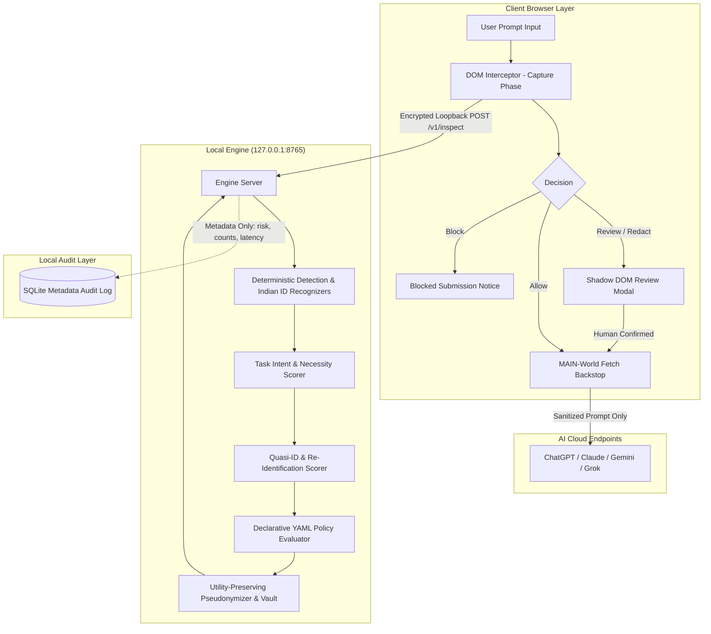

# VeilGuard AI: Context-Aware Privacy Firewall for AI Tools

> Context-aware privacy firewall operating between users and AI endpoints to intercept submissions, evaluate context-dependent risks, enforce deterministic policy actions, and sanitize sensitive data with zero external telemetry.

**Team:** Team Vexora  
**Event:** DevHack 2026  
**Problem Statement:** PS 2.2 — Context-Aware Data Privacy under Responsible AI  
**License:** GNU Affero General Public License v3.0 ([AGPL-3.0](./LICENSE))  
**Web Demo:** [https://veilguard-ai.vercel.app](https://veilguard-ai.vercel.app) *(limited, rules-only, runs entirely in your browser; the full engine runs locally)*

---

## The Problem (Problem Statement 2.2)

Users frequently paste customer conversations, financial records, medical notes, and source code containing secrets into public AI interfaces and APIs. Simple keyword- or regex-based redaction tools fail on indirect, combined, or contextual quasi-identifiers, while aggressively destroying benign text necessary for AI utility. VeilGuard AI solves this by intercepting prompt submissions directly within the client, evaluating context-dependent privacy risks on a local loopback engine, enforcing deterministic policy actions, and generating utility-preserving pseudonymized prompts.

---

## What VeilGuard AI Does

- **In-Browser & Network Interception:** Captures DOM submit events (Send clicks, Enter keypresses, React-controlled states) in the capture phase before requests leave the page, reinforced by a MAIN-world fetch and XHR backstop.
- **Local Context Intelligence:** Evaluates text on a local loopback engine (`127.0.0.1:8765`) using Presidio, custom ID recognizers, quasi-identifier combination scoring, and task necessity inference in sub-40ms latency.
- **Deterministic Policy Enforcement:** Enforces declarative YAML rules (`strict`, `balanced`, `developer`) with deterministic outcomes (`allow`, `redact`, `require_approval`, `block`), ensuring the critical path never depends on non-deterministic external LLMs.
- **Utility-Preserving Pseudonymization:** Replaces non-essential sensitive tokens with contextual placeholders (`[CUSTOMER_1]`, `****-1234`) backed by an in-memory session vault for consistent multi-turn dialogue.
- **Strict Zero-Telemetry Privacy:** Operates entirely on the local loopback boundary; raw prompts and documents are never persisted to disk or sent to external servers, recording strictly metadata-only audit logs.

---

## System Architecture




## Empirical Evidence & Verification

All figures below originate directly from reproducible benchmark artifacts in `bench/results/` as documented in [docs/EVIDENCE.md](./docs/EVIDENCE.md).

### 1. Headline Benchmark Results (Sealed Test Split)
Evaluated on the frozen, synthetic evaluation test corpus (**N=286 records**, Run #2, commit `2701793`):

| System | Entity F1 (50% IoU) | Exact Entity F1 | Flagged Precision | Flagged Recall | False Positive Rate (FPR) | Quasi-ID Combo Recall | Required Tokens Retained |
| :--- | :--- | :--- | :--- | :--- | :--- | :--- | :--- |
| **Regex / Keyword Baseline** | 56.3% | 51.4% | 97.3% | 79.2% | 3.9% | 17.1% | 96.7% |
| **Microsoft Presidio (Default)** | 22.6% | 22.3% | 60.5% | 72.7% | 84.5% | 97.1% | 63.5% |
| **Presidio (All Stock Recognizers)** | 24.6% | 23.9% | 63.3% | 83.1% | 85.4% | 97.1% | 62.4% |
| **VeilGuard (Type-Based Only)** | 43.4% | 41.3% | 100.0% | 56.8% | 0.0% | 0.0% | 100.0% |
| **VeilGuard AI (Full Intelligence)** | **73.2%** | **65.3%** | **100.0%** | **84.2%** | **0.0%** | **80.0%** | **100.0%** |

*Note on False Positive Rate & Quasi-ID Combination Recall:* Stock Presidio flagged 97.1% of combination prompts at the cost of an **84.5% false positive rate** (flagging 87 of 103 benign prompts indiscriminately). VeilGuard AI achieves **80.0% combination recall** with **0.0% FPR** (0 of 103 benign items falsely flagged, 95% Wilson CI [0.0%, 3.6%]) by pairing deterministic policy rules with checksum validation and task necessity gating.

### 2. End-to-End Browser Enforcement Matrix
Tested on the **Mock AI Chat Testbed** with real loopback engine (`127.0.0.1:8765`):
- **Matrix Cells Verified:** 14 / 14 cells PASS (280 flagged trials across form submits, button clicks, Enter keypresses, controlled React states, and fetch/XHR backstop).
- **Plain-Text Leaks Observed:** 0 leaks across 280 trials (`bench/results/enforcement_full_chain_mock_site.json`).

---

## Supported AI Interfaces

Per Rule 3 of `AGENTS.md`, interfaces are labeled **Verified** only when backed by recorded multi-trial benchmark cells ($N \ge 20$). All other interfaces are labeled **Prototype**:

| Target Interface | Status | Interception Mechanism | Evidence |
| :--- | :--- | :--- | :--- |
| **Mock AI Chat Testbed** (`127.0.0.1:4310`) | **Verified** | Form submit, Send click, Enter key, Controlled React state, Fetch/XHR backstop | 280 / 280 trials passed, 0 leaks (`bench/results/enforcement_full_chain_mock_site.json`) |
| **ChatGPT** (`chatgpt.com`) | **Prototype** | Contenteditable / ProseMirror adapter + MAIN-world fetch backstop | Unauthenticated mobile-web send button & backstop verified (`bench/results/enforcement_real_site.json`) |
| **Google Gemini** (`gemini.google.com`) | **Prototype** | Universal Rich-Text / Quill adapter + fetch backstop | Mapped in `extension/src/content/adapters/universal.ts` |
| **Anthropic Claude** (`claude.ai`) | **Prototype** | ProseMirror adapter + fetch backstop | Mapped in `extension/src/content/adapters/universal.ts` |
| **Microsoft Copilot** (`copilot.microsoft.com`) | **Prototype** | Shadow DOM / Iframe traverse adapter + fetch backstop | Mapped in `extension/src/content/adapters/universal.ts` |
| **Perplexity AI** (`perplexity.ai`) | **Prototype** | Textarea / form submit adapter + fetch backstop | Mapped in `extension/src/content/adapters/universal.ts` |
| **Grok** (`grok.com`, `x.ai`) | **Prototype** | Universal Contenteditable / Textarea adapter + fetch backstop | Mapped in `extension/src/content/adapters/universal.ts` |
| **DeepSeek Chat** (`chat.deepseek.com`) | **Prototype** | Textarea adapter + fetch backstop | Mapped in `extension/src/content/adapters/universal.ts` |

---

## Implementation Status

Feature status is strictly tracked in [docs/STATUS.md](./docs/STATUS.md) per Rule 2 of `AGENTS.md`:

| Component / Feature | Phase | Status | Verification Reference |
| :--- | :--- | :--- | :--- |
| **Mock AI Chat Testbed** | Phase 1 | **Implemented** | `mock-ai-site/server.mjs`; `bench/results/enforcement_mock_site.json` |
| **Presidio & Indian ID Recognizers** | Phase 2 | **Implemented** | `tests/engine/test_india_detectors.py` (34 passed, 3 documented xfail) |
| **Local Engine API (`/v1/inspect`)** | Phase 2/3a | **Implemented** | `tests/engine/test_api_security.py` (Bearer auth, loopback binding) |
| **Declarative YAML Policy Engine** | Phase 3a | **Implemented** | `tests/engine/test_policy_loader.py`, `test_policy_evaluator.py` |
| **DOM Interception & Dual Backstop** | Phase 3b | **Implemented** | `tests/e2e/enforcement-full-chain.spec.ts` (14/14 cells, 0 leaks) |
| **Shadow DOM Review Overlay** | Phase 3b | **Implemented** | `tests/e2e/scenarios.spec.ts` (XSS, Emoji, untrusted click protection) |
| **Session Pseudonym Vault** | Phase 3b | **Implemented** | `tests/e2e/scenarios.spec.ts` (`scenario:vault-consistency`) |
| **Metadata-Only Audit Dashboard** | Phase 3c | **Implemented** | `tests/e2e/dashboard-popup.spec.ts` (12 tests pass, zero raw persistence) |
| **Degraded Mode & Backstop Canary** | Phase 4 | **Implemented** | `tests/e2e/degraded-canary.spec.ts` (10/10 trials protected) |
| **Real-Site Boundary Harness** | Phase 4 | **Implemented** | `tests/e2e-real/chatgpt.spec.ts` (opt-in `VG_REAL_SITE=1`, requests stubbed) |
| **Task Intent & Necessity Matrix** | Phase 5 | **Implemented** | `tests/engine/test_task_inference.py`, `test_necessity.py` |
| **Quasi-ID & Re-Identification Scorer** | Phase 5 | **Implemented** | `tests/engine/test_reid.py` (80.0% combo recall in sealed benchmark) |
| **Utility-Preserving Sanitizer** | Phase 5 | **Implemented** | `tests/engine/test_role_placeholders.py` (100.0% required token retention) |
| **PyMuPDF Document Redactor & Web Sanitizer** | Phase 6 | **Implemented** | `tests/engine/test_pdf.py` (11 tests pass), `web/src/components/PDFRedactor.tsx` |
| **Blue Glass Design System** | Part 2 | **Implemented** | `extension/src/shared/design-tokens.css`, `tests/unit/contrast.test.ts` |
| **Windows Desktop App & Sidebar** | Part 4 | **Implemented** | `desktop/app_main.py`, `desktop/sidebar_guard.py`, `Launch-VeilGuard-Desktop.bat` |
| **Static Web Demo on Vercel** | Part 5 | **Implemented** | `web/src/App.tsx`, `web/src/components/PDFRedactor.tsx`, [veilguard-ai.vercel.app](https://veilguard-ai.vercel.app) |
| **Zero-Click Loopback Auto-Pairing** | Part 5 | **Implemented** | `engine/veilguard_engine/server.py` (`/auth/pair`), `tests/engine/test_api_security.py` |
| **Silent Windows Auto-Start Background Service** | Part 5 | **Implemented** | `scripts/enable-autostart.ps1`, `Start-VeilGuard-Background.bat` |
| **Response Vault Rehydration** | Phase 7 | **Future** | Post-hackathon roadmap — client-side closed Shadow DOM rehydration |

---

## Quick Start Guide

### Automated Setup

#### Windows (PowerShell):
```powershell
.\scripts\setup.ps1
```

#### macOS / Linux:
```bash
chmod +x scripts/setup.sh
./scripts/setup.sh
```

---

### Manual Setup & Execution

#### 1. Python Engine Setup
```bash
# Create and activate virtual environment
python -m venv .venv

# Activate environment:
# Windows PowerShell: .\.venv\Scripts\Activate.ps1
# macOS/Linux: source .venv/bin/activate

# Install dependencies and spaCy language model
pip install --upgrade pip
pip install -r engine/requirements.txt -r engine/requirements-dev.txt
python -m spacy download en_core_web_sm
```

#### 2. Extension Build
```bash
npm install
npm run build
```

#### 3. Start the Local Engine & Testbed
1. **Start the local loopback engine (127.0.0.1:8765):**
   ```bash
   python -m veilguard_engine.server
   ```
2. **Start the mock AI chat testbed (127.0.0.1:4310):**
   ```bash
   npm run mock-site
   ```
3. **Load the unpacked extension into Chrome:**
   - Navigate to `chrome://extensions/`.
   - Enable **Developer mode** (top right toggle).
   - Click **Load unpacked** and select the `extension/dist` folder.
4. **Pair the Token:**
   - The extension automatically pairs with `127.0.0.1:8765` on first run via loopback auto-pairing.
   - You can also view or set the Bearer token in extension **Options**.
5. **Try a Sample Prompt:**
   - Open `http://127.0.0.1:4310/`.
   - Paste a sample prompt from [docs/DEMO_PROMPTS.md](./docs/DEMO_PROMPTS.md) and press **Enter**.
   - Observe the Shadow DOM review overlay and approve the sanitized submission.

---

## Windows Desktop Application & Sidebar

VeilGuard AI includes a native Windows desktop companion that extends protection to desktop AI apps and clipboard workflows:

- **Launch:** Run `Launch-VeilGuard-Desktop.bat` or execute `python desktop/app_main.py`.
- **Background Mode:** Run `Start-VeilGuard-Background.bat` to launch the engine and desktop tray companion silently.
- **Stop Service:** Run `Stop-VeilGuard.bat` to terminate background processes.
- **Build Standalone Binary:** Run PyInstaller using `pyinstaller VeilGuard.spec`. The resulting bundle is located in `dist/VeilGuard/VeilGuard.exe`.

> [!NOTE]
> **Windows SmartScreen & Checksums:** Standalone executable builds distributed in GitHub Releases are open-source and unsigned. Windows Defender or SmartScreen may display an "Unrecognized app" notice on initial launch. Click **More info -> Run anyway**. Exact cryptographic SHA-256 checksums are published with every release (`SHA256SUMS.txt`).

---

## Web Demo (Vercel)

A static web demonstration is hosted at **[https://veilguard-ai.vercel.app](https://veilguard-ai.vercel.app)**.
- **Scope:** Runs client-side rules, regex parsers, and browser-native PDF stream sanitization directly in your browser.
- **Privacy Notice:** *Limited, rules-only, runs entirely in your browser; the full engine runs locally.* No prompt or document data is transmitted to any cloud backend.

---

## Sample Prompts & Verification Documents

Synthetic test prompts and evaluation PDFs are provided in the repository:
- **Sample Prompt Pack:** [docs/DEMO_PROMPTS.md](./docs/DEMO_PROMPTS.md)
- **Synthetic Business Report PDF:** [samples/VeilGuard_Test_Business_Report.pdf](./samples/VeilGuard_Test_Business_Report.pdf)
- **Synthetic Financial Statement PDF:** [samples/VeilGuard_Test_Loan_Expense_Statement.pdf](./samples/VeilGuard_Test_Loan_Expense_Statement.pdf)

---

## Running Tests & Reproducing Benchmarks

All test suites can be executed independently.

```bash
# 1. Python Engine Unit & Policy Tests (169 tests: 166 passed, 3 documented xfail)
pytest -rx

# 2. In-Memory Extension Unit Tests (35 tests)
npm run test:unit

# 3. TypeScript Static Typecheck (strict typing)
npm run typecheck

# 4. Production Build Verification
npm run build

# 5. End-to-End Browser Scenarios (Playwright)
npm run test:e2e

# 6. Benchmark Evaluation on Development Split (N=233)
python -m bench.run_benchmark --split dev --systems all

# 7. Verify Integrity of Evidence Report
python scripts/make_evidence.py --check
```

> **Frozen Test Split Notice:** The test split (**N=286 records**, SHA-256 `335a7ad7739b86f71c062fc51ff43fdc239d9a4d198302c7700138ee3e28242d`) is cryptographically sealed. Every test run is permanently appended to `bench/results/test_run_log.jsonl` with timestamp, commit hash, and hardware specifications to prevent test-set over-fitting.

---

## Known Boundaries & Limitations

In accordance with Rules 1, 3, and 4 of `AGENTS.md`, VeilGuard AI candidly documents its operational boundaries. Detailed limitations are maintained in [docs/LIMITATIONS.md](./docs/LIMITATIONS.md):

1. **Statistical NER Sensitivity:** Compact offline models (`en_core_web_sm`) rely on grammatical and capitalization cues; uncapitalized or transliterated names without surrounding context may be missed.
2. **Ambiguous Numeric Identifiers:** Isolated 10-digit numbers without context or checksums cannot be reliably distinguished from benign tracking IDs or part numbers.
3. **Scanned / Raster-Only PDFs:** PDF redaction inspects vector glyphs and text streams. Scanned raster-only images require an upstream optical character recognition (OCR) pipeline.
4. **Insider Bypasses:** VeilGuard protects against inadvertent employee leaks and web interface exposure. An actor with administrative OS privileges or browser developer tools can bypass local client controls.

---

## Privacy & Security Policies

- **Privacy Policy & Invariants:** [PRIVACY.md](./PRIVACY.md) — Strictly metadata-only audit logs, loopback binding only (`127.0.0.1`), zero telemetry.
- **Security Policy:** [SECURITY.md](./SECURITY.md) — Vulnerability reporting and fail-closed posture.
- **Third-Party Credits:** [THIRD_PARTY_NOTICES.md](./THIRD_PARTY_NOTICES.md) — Full attribution and license catalog.
- **Architecture Documentation:** [docs/ARCHITECTURE.md](./docs/ARCHITECTURE.md)
- **API Documentation:** [docs/API.md](./docs/API.md)
- **Policy Engine Specification:** [docs/POLICY.md](./docs/POLICY.md)
- **Operational Workflow:** [docs/WORKFLOW.md](./docs/WORKFLOW.md)
- **Design System:** [docs/DESIGN_SYSTEM.md](./docs/DESIGN_SYSTEM.md)
- **Windows App Guide:** [docs/WINDOWS_APP.md](./docs/WINDOWS_APP.md)
- **Licensing Analysis:** [docs/LICENSING.md](./docs/LICENSING.md)

---

## License

This project is licensed under the **GNU Affero General Public License v3.0** ([AGPL-3.0](./LICENSE)).  
Copyright (C) 2026 Team Vexora, DevHack 2026.
