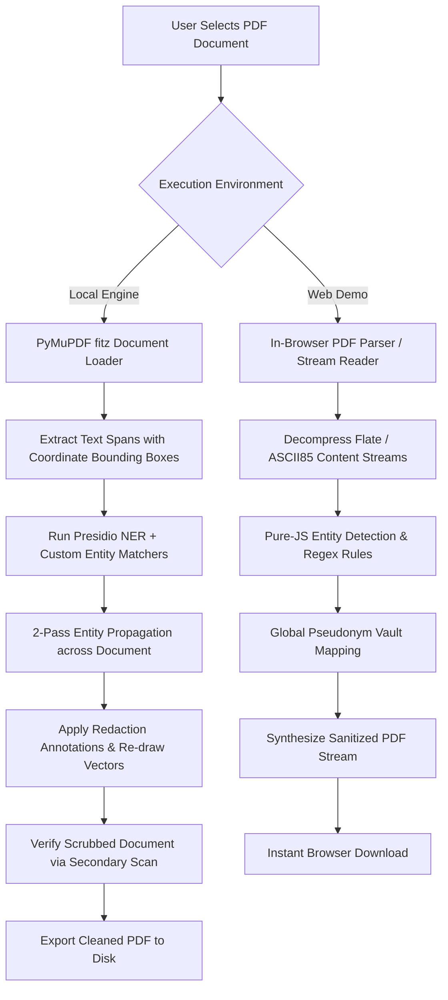
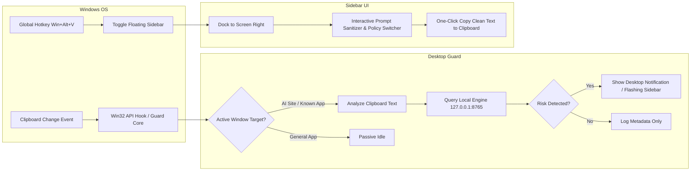

# VeilGuard AI: Operational Workflow

VeilGuard AI operates as an intelligent, context-aware privacy firewall positioned between the user and AI endpoints (ChatGPT, Claude, Gemini, Grok, Perplexity, DeepSeek, and custom APIs). This document details the end-to-end execution workflows across the browser extension, document processing pipeline, desktop application, and audit logging subsystems.

---

## 1. Browser Prompt Interception Workflow

```mermaid
sequenceDiagram
    autonumber
    actor User
    participant Page as Web Application (e.g., ChatGPT)
    participant Ext as Chrome Extension (Content Script)
    participant Bkg as Service Worker (Background)
    participant Engine as Local Python Engine (127.0.0.1:8765)
    participant AI as Provider Cloud Endpoint

    User->>Page: Types prompt containing PII/Secrets & presses Enter
    Ext->>Page: Intercepts submit event (Event.stopImmediatePropagation)
    Ext->>Bkg: Dispatches prompt payload + target domain metadata
    Bkg->>Engine: POST /v1/inspect (Auth: Bearer Token)
    Engine->>Engine: Deterministic Detection (Presidio + Regex + Keywords)
    Engine->>Engine: Policy Engine Evaluation (Strict / Balanced / Dev)
    Engine->>Engine: Pseudonymization & Reversible Vault Generation
    Engine-->>Bkg: InspectionResult (Decision, Risk Score, Entities, Sanitized Text)
    Bkg-->>Ext: Dispatches InspectionResult
    alt Decision == "allow"
        Ext->>Page: Re-injects original prompt & dispatches synthetic submit
        Page->>AI: Sends unredacted query to AI provider
    else Decision == "redact" or Decision == "require_approval"
        Ext->>Ext: Renders VeilGuard In-Context Review Modal
        User->>Ext: Reviews entity breakdown, diff, and approves sanitized text
        Ext->>Page: Injects pseudonymized prompt into textarea
        Ext->>Page: Dispatches synthetic submit event
        Page->>AI: Sends sanitized query to AI provider
    else Decision == "block"
        Ext->>Ext: Displays Block Notification (Critical Violation)
        Ext->>Page: Halts submission entirely; prompt is preserved for user editing
    end
```

### Steps Explained
1. **Event Interception**: Content scripts inject adapter listeners matching specific site selectors (e.g., `#prompt-textarea`, `div[contenteditable="true"]`). Synthetic or native user submit events are captured in the capture phase.
2. **Local Token Verification**: Background workers communicate with `127.0.0.1:8765` using an API pairing token generated during local engine initialization.
3. **Local Risk Analysis**: The local engine executes rule-based pattern matching, Named Entity Recognition (NER), context-window scoring, and quasi-identifier link analysis in sub-50ms latency.
4. **Deterministic Policy Action**: Policies (`strict.yaml`, `balanced.yaml`, `developer.yaml`) determine whether the prompt should be allowed, redacted with human confirmation, or hard-blocked.
5. **Human-in-the-Loop Confirmation**: If sensitive entities are discovered, a glassmorphic modal presents an interactive diff. The user can toggle individual redactions or approve wholesale pseudonymization.

---

## 2. Document Sanitization Workflow (PDF Redaction)

VeilGuard AI offers dual-engine PDF redaction: high-fidelity server-side sanitization via PyMuPDF in the local Python engine, and instant zero-dependency client-side sanitization in the Web Demo (`web/src/components/PDFRedactor.tsx`).



### Key PDF Safeguards
- **2-Pass Entity Propagation**: Entities discovered in one paragraph (e.g., full customer name) are automatically mapped and scrubbed throughout subsequent pages even if referenced by partial tokens (e.g., surname only).
- **Physical Bounding Box Redaction**: Rather than drawing visual black rectangles over text (which leaves underlying text streams extractable), PyMuPDF completely strips the glyphs and re-renders the document structure.
- **Verification Scan**: The engine automatically runs an extraction pass on the generated output to confirm zero residual PII before returning the file.

---

## 3. Windows Desktop Application & Clipboard Guard Workflow

The Windows desktop client (`desktop/app_main.py` and `desktop/sidebar_guard.py`) provides system-wide privacy defense outside the browser.



---

## 4. Audit & Metadata Logging Workflow

VeilGuard AI enforces strict privacy invariants: **raw prompts, personal documents, and conversation texts are never written to disk or transmitted externally**.

1. **Transaction Generation**: Every inspection creates an ephemeral analysis record in memory.
2. **Metadata Extraction**:
   - `timestamp`: UTC ISO 8601 string.
   - `decision`: `allow`, `redact`, `require_approval`, or `block`.
   - `risk_score`: Normalized numeric score (0 to 100).
   - `matched_rules`: List of policy rule identifiers (e.g., `RULE_CREDIT_CARD`, `RULE_AWS_KEY`).
   - `entity_counts`: Aggregated entity counts (e.g., `{"PERSON": 2, "EMAIL_ADDRESS": 1}`).
   - `latency_ms`: Processing time.
3. **Storage**: Stored in a local, encrypted or access-restricted SQLite metadata database (`metadata_audit.db`).
4. **Zero Content Persistence**: Prompt strings, replacement values, and pseudonymization maps reside exclusively in volatile memory for the duration of the request session.
